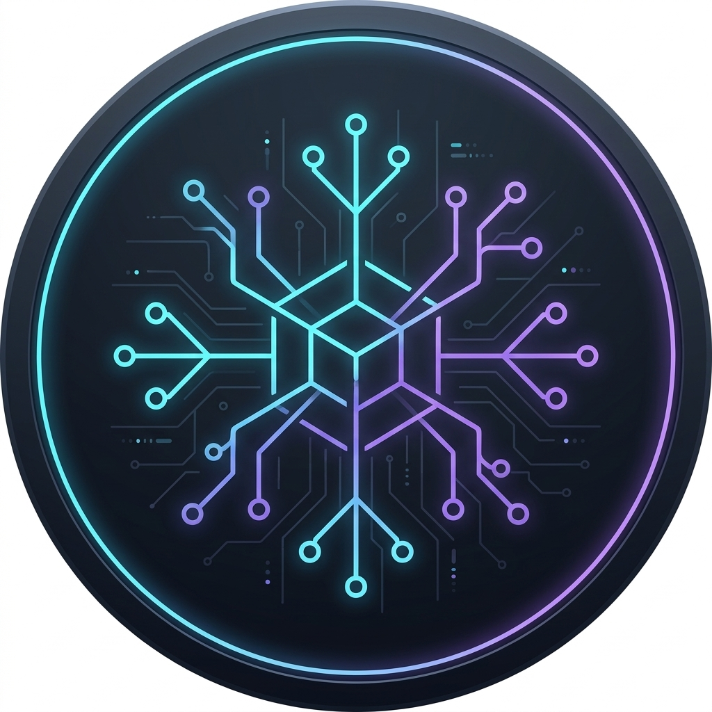

  <!-- Profile Image -->
  

  <h1>Hi, I'm <a href="https://github.com/Potentialishere">Potentialishere</a> 👋</h1>
  
<strong>Software Engineering Undergraduate | Machine Learning, Cloud & API Development</strong>

  <!-- Credly & External Links -->
  
  
  

 

---

### 🛠️ Technical Stack & Focus Areas

  
  
  
  
  
  

---

### 📌 Featured Projects

<table>
  <tr>
    <td width="50%">
      <h3 align="center">🌤️ Weather Info Application</h3>
      

        A Python-based application using the Open-Meteo REST API in Google Colab to retrieve live metrics and reverse geocoding data.
      

      

        
        
      

      

        <a href="https://github.com/Potentialishere/weather-api-application"><strong>View Repository »</strong></a>
      

    </td>
    <td width="50%">
      <h3 align="center">🎮 Mobile Game Project</h3>
      

        A mobile game project built in C#, exploring game mechanics, graphics rendering, and logic implementation.
      

      

        
        
      

      

        <a href="https://github.com/Potentialishere/Project001"><strong>View Repository »</strong></a>
      

    </td>
  </tr>
</table>

---

### 📊 GitHub Activity & Analytics

  
  

 

  

